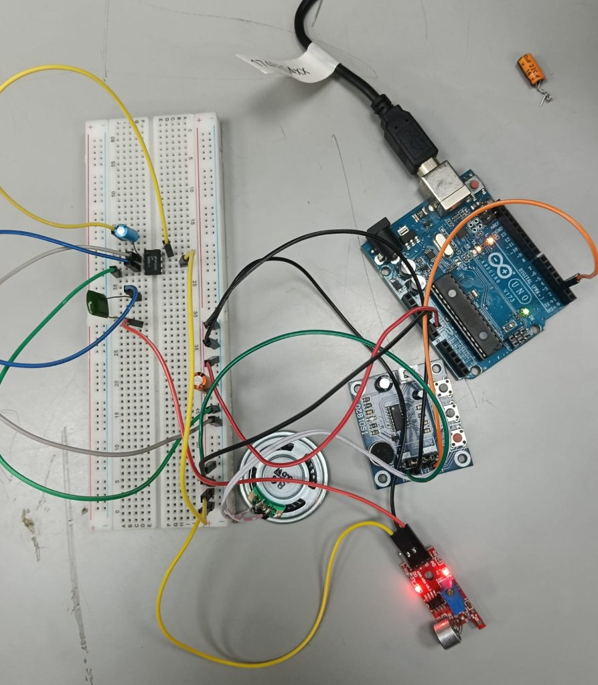
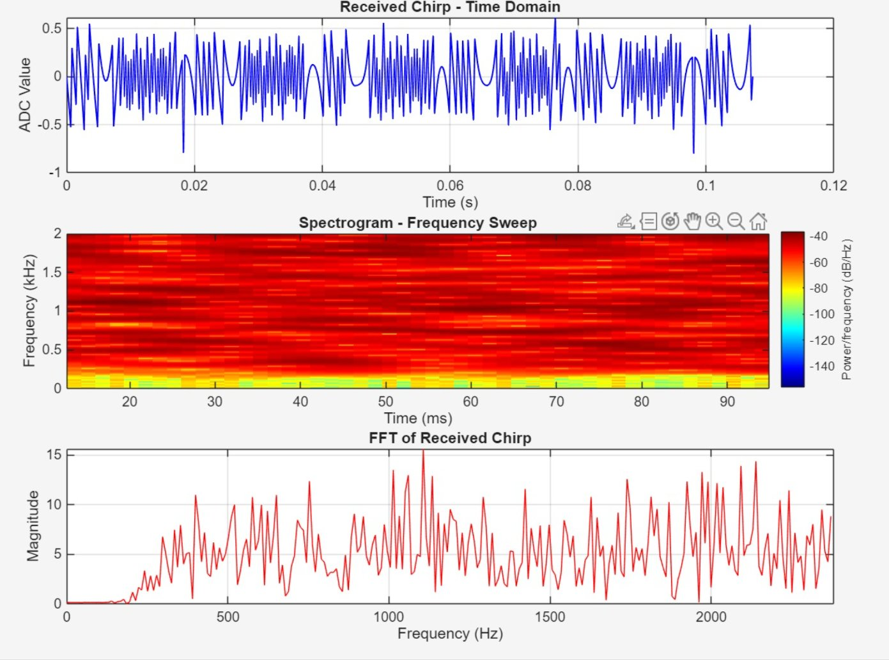
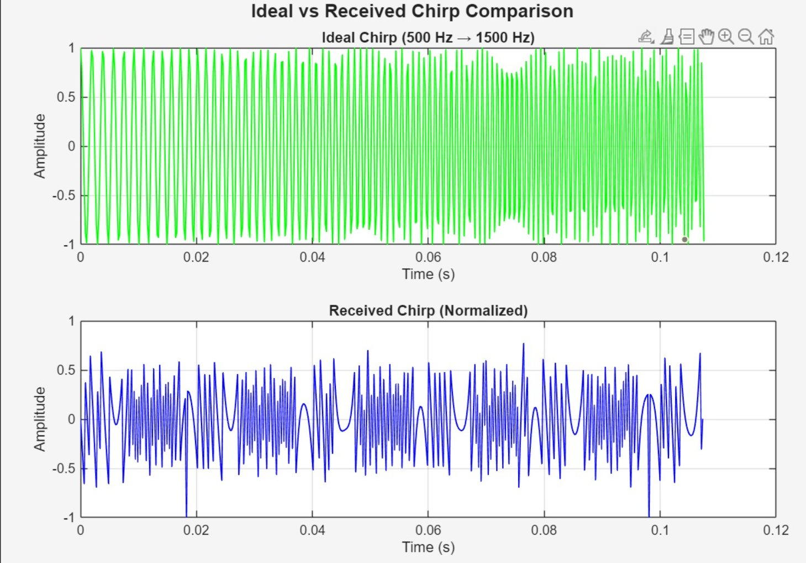
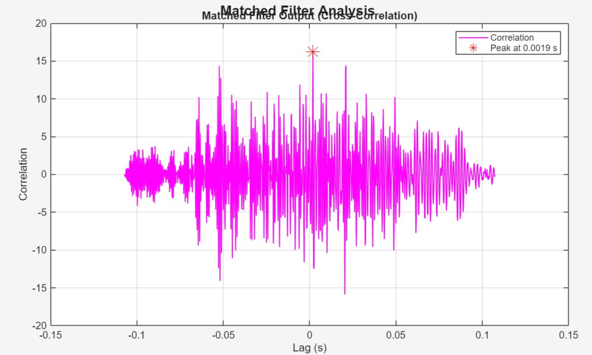

# Noise-Robust Chirp Signal Communication using Matched Filtering

This project sends a linear chirp (a tone sweeping from 500 Hz to 1500 Hz) over the air, records it with a microphone on an Arduino UNO, and detects it in MATLAB with a matched filter (cross-correlation against an ideal chirp template). The aim is to show why a wideband chirp is easier to pick out of room noise than a single tone.

| | |
|---|---|
| **Course** | ELP311, IIT Delhi |
| **Supervisor** | Prof. Swades De |
| **Date** | April 2026 |
| **Team** | Group 04 (Thursday): Aarzoo, Ishanee Neb, Apurva, Kabir Kashyap |

## How it works

```
MATLAB chirp gen -> PC speaker -> ISD1820 (record/replay) -> air + room noise
                 -> HW-484 mic -> Arduino UNO ADC (4761 Hz) -> serial -> MATLAB analysis
```

1. `matlab/generate_chirp.m` makes a 0.5 s chirp from 500 Hz to 1500 Hz and plays it through the PC speaker.
2. The ISD1820 voice-recorder module records the chirp so it can replay it on demand.
3. `arduino/chirp_capture/chirp_capture.ino` pulses the ISD1820 PLAYE pin (D2), waits 100 ms, then samples the HW-484 microphone on A0. It takes 512 samples at 4761 Hz, about 107 ms of signal, and streams them over serial as `timestamp_us,adc_value`. It repeats every 3 s.
4. `matlab/chirp_analysis.m` loads the captured samples. It removes DC and drift (detrend and a 3rd-order 300 Hz Butterworth high-pass with `filtfilt`), then plots the time signal, spectrogram and FFT. Finally it cross-correlates the received signal with an ideal chirp template and reports the peak lag.

## Hardware



| Component | Role |
|---|---|
| Arduino UNO | Triggers the ISD1820 on D2; samples the mic on A0 at 4761 Hz |
| ISD1820 module | Stores the recorded chirp and replays it when PLAYE is pulsed |
| HW-484 mic module | Electret microphone; its analog out (AO) goes to A0 |
| Breadboard, wires, capacitor | Interconnects; capacitor on the mic line for DC blocking |
| PC speaker | Plays the MATLAB chirp so the ISD1820 can record it |

## Signal parameters

- Instantaneous frequency: f(t) = f0 + k·t = 500 + 2000·t Hz, for 0 ≤ t ≤ 0.5 s
- Chirp rate: k = (f1 − f0) / T = (1500 − 500) / 0.5 = 2000 Hz/s
- Signal: x(t) = sin(2π·(500·t + 1000·t²))
- Bandwidth B = 1000 Hz, so the time-bandwidth product is B·T = 500
- Sampling rate fs = 4761 Hz, which is above the Nyquist rate of 2 × 1500 = 3000 Hz
- 512 samples, so FFT resolution is 4761 / 512 ≈ 9.3 Hz
- Matched filter: R[m] = Σ r[n]·x[n + m], where r is the received signal and x is the template

## Results

**Received signal: time domain, spectrogram and FFT.** After filtering, the energy is spread across the band rather than sitting in one spike, which is what you expect from a chirp and not from a pure tone.



**Ideal vs received chirp.** Room acoustics and noise distort the amplitude, but the sweep pattern is still visible.



**Matched filter output.** The correlation peaks at a lag of 0.0019 s (1.9 ms), inside the 50 ms detection threshold used in the script.



## Running it

**Requirements:** Arduino IDE; MATLAB with the Signal Processing Toolbox (`chirp`, `butter`, `filtfilt`, `spectrogram`, `xcorr`).

1. Wire PLAYE of the ISD1820 to D2 and the HW-484 AO pin to A0. Share 5 V and GND across all modules.
2. Run `generate_chirp.m` in MATLAB and hold the ISD1820 REC button while the chirp plays, so it records the chirp.
3. Upload `arduino/chirp_capture/chirp_capture.ino` and open the Serial Monitor at 115200 baud.
4. Copy **one** capture (the lines between `--- CHIRP START ---` and `--- CHIRP END ---`) into `matlab/chirp_data.txt`. Text lines are dropped automatically, because they load as NaN.
5. Run `chirp_analysis.m` from the `matlab/` folder.

Captured data files are not included in this repo, so you need your own capture to reproduce the plots.

## Notes and limitations

- The Arduino records about 107 ms, but the transmitted chirp is 0.5 s long, so each capture holds only part of the sweep. The analysis template sweeps the full 500–1500 Hz within the capture length, so it is a simplified template rather than an exact copy of the captured segment.
- The sample interval is integer microseconds (1000000 / 4761 = 210 µs), so the true rate is about 4762 Hz. This is close enough for these plots.
- The single-tone comparison is qualitative: the code analyses the chirp only.

## Contributions

This was a four-person group project:

| Member | Work |
|---|---|
| Aarzoo | Arduino code (trigger logic, ADC sampling, serial streaming); hardware assembly and wiring |
| Ishanee Neb | MATLAB chirp generation and speaker playback; FFT analysis and plot formatting |
| Apurva | MATLAB spectrogram and signal statistics; ISD1820 recording and verification |
| Kabir Kashyap | MATLAB matched filter (cross-correlation); report, presentation and result interpretation |

## References

1. J. G. Proakis and D. G. Manolakis, *Digital Signal Processing*, 4th ed.
2. MATLAB documentation: `chirp`, `xcorr`, `spectrogram`
3. ISD1820 datasheet
4. Arduino UNO reference
5. M. I. Skolnik, *Introduction to Radar Systems* (matched filter theory)
